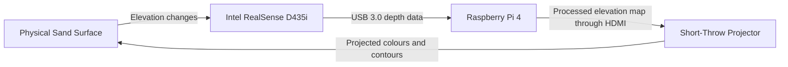

# CEG1010 Group 4 — Augmented Reality Sandbox

An augmented reality sandbox built for the Raspberry Pi using an Intel RealSense D435 / D435i depth camera. The system scans the sand, calibrates a baseline, and projects a live, colour-coded topography map (with contour lines and water effects) directly onto the sand as it is shaped.

## System Overview

The system operates as a continuous feedback loop:



The RealSense camera measures the sand height. The Raspberry Pi processes the depth data and generates the elevation colours and contour lines. The projector then displays the processed image back onto the sand.

---

## Hardware Requirements

- Raspberry Pi 4
- Raspberry Pi case with cooling fan
- MicroSD card with Raspberry Pi OS
- Intel RealSense D435i
- USB 3.0 data cable
- Short-throw projector
- Micro-HDMI-to-HDMI cable or adapter
- Compatible Raspberry Pi USB-C power supply 
- Power strip 

## Software Requirements

- Python 3.13 (aarch64 / Linux — a prebuilt `pyrealsense2` binary for this exact platform is included)
- OpenCV and NumPy (see `requirements.txt`)
- `librealsense` core SDK installed on the system (not included in this repo) — see [realsenseai/librealsense](https://github.com/realsenseai/librealsense)

### Connection diagram

```text
Intel RealSense D435i
        │
        │ USB 3.0
        ▼
  Raspberry Pi 4
        │
        │ Micro-HDMI to HDMI
        ▼
Short-Throw Projector
        │
        │ Projected elevation map
        ▼
    Sand Surface


Wall Outlet
     │
     ▼
 Power Strip
   ├── Raspberry Pi power supply
   └── Projector power cable
```

---

## Initial Alignment

Position the projector so that the image fully covers the sandbox, then adjust the RealSense camera until the entire sand surface is centred in the depth preview. Ensure both devices are parallel to the sandbox and tighten all mounts securely. Recalibration may be required if the camera, projector or sandbox is moved.

---

## Recommended Start-Up Procedure

1. Place the frame on a stable and level table.
2. Confirm that all brackets and mounting screws are tight.
3. Insert the sandbox into its bracket and T-slot restraints.
4. Connect the RealSense camera to a USB 3.0 port.
5. Connect the Raspberry Pi to the projector through HDMI.
6. Connect the Raspberry Pi and projector to the power strip.
7. Switch on the projector and select the HDMI input.
8. Power on the Raspberry Pi.
9. Allow the Raspberry Pi to finish booting.
10. Keep the sandbox surface clear and stable before calibration.
11. Start the AR sandbox program.

## Installation

1. **Install system dependencies** (Raspberry Pi OS / Debian-based):
   ```bash
   sudo apt update
   sudo apt install python3-pip git cmake build-essential libssl-dev \
       libusb-1.0-0-dev libudev-dev pkg-config libgtk-3-dev
   ```

2. **(Optional) Create a virtual environment.** Keeps project dependencies isolated from the system Python:
   ```bash
   python3 -m venv venv
   source venv/bin/activate
   ```
   You'll need to run `source venv/bin/activate` again in any new terminal session before running the project. If you skip this step, dependencies install to the system Python instead.

3. **Install the `librealsense` core SDK.** This provides the `librealsense2` shared libraries that the bundled `pyrealsense2` binding depends on at runtime:
   ```bash
   git clone https://github.com/realsenseai/librealsense.git
   cd librealsense
   mkdir build && cd build
   cmake .. -DBUILD_PYTHON_BINDINGS=false -DCMAKE_BUILD_TYPE=Release
   make -j$(nproc)
   sudo make install
   sudo ldconfig
   ```
   Follow the official [Raspberry Pi guide](https://dev.realsenseai.com/docs/using-depth-camera-with-raspberry-pi-3) or [Linux guide](https://github.com/realsenseai/librealsense/blob/master/doc/installation.md) for platform-specific dependencies and build flags. This step can take a while on a Pi — the -j$(nproc) flag above speeds it up if you have enough RAM/swap. Consider also running it inside tmux or screen so an SSH/VNC disconnect doesn't kill the build partway through.

   Verify the install:
   ```bash
   ldconfig -p | grep realsense
   ```
   This should list `librealsense2.so`. If it returns nothing, the SDK isn't installed or isn't on the linker path yet.

4. **Install the RealSense udev rules.** This is required for the camera to be accessible without root privileges:
   ```bash
   sudo cp system/99-realsense-libusb.rules /etc/udev/rules.d/
   sudo udevadm control --reload-rules
   sudo udevadm trigger
   ```
   Unplug and replug the camera after this step.

5. **Verify the `pyrealsense2` Python bindings.**
   This repo includes a prebuilt binary for Python 3.13 on aarch64 Linux (`pyrealsense2.cpython-313-aarch64-linux-gnu.so`), no installation is needed.

   Confirm it's importable:
   ```bash
   cd /path/to/this/project
   python3 -c "import pyrealsense2 as rs; print(rs.__file__)"
   ```
   If this prints a file path, you're done with this step.

   **If it fails:**
   - `ImportError` mentioning `librealsense2.so` → the core SDK from step 3 isn't installed, or `ldconfig` wasn't refreshed. Go back to that step.

6. **Install the remaining Python dependencies:**
   ```bash
   pip install -r requirements.txt
   ```
   Add `--break-system-packages` if you skipped the virtual environment in step 2 and hit an `externally-managed-environment` error.

7. **Verify the camera is working:**
   ```bash
   python3 test_realsense.py
   ```
   This should open two windows showing the live colour and depth feeds. Press `q` to quit.


## Uploading Code to the Pi

From your computer, copy the project folder to the Pi over SSH using `scp`. Works from PowerShell, Git Bash, or any terminal with `scp` available.

**Windows (PowerShell or Git Bash):**
```bash
scp -r "C:\path\to\your\project" pi_username@PI_IP_ADDRESS:/home/pi_username/Desktop/
```

**macOS / Linux:**
```bash
scp -r /path/to/your/project pi_username@PI_IP_ADDRESS:/home/pi_username/Desktop/
```

- Find the Pi's IP address by running `hostname -I` on the Pi itself.
- SSH must be enabled on the Pi first: `sudo raspi-config` → Interface Options → SSH → Enable.
- This re-copies the whole folder and overwrites any files that changed — safe to re-run every time you have local edits to push.
- If your folder path has spaces in it, keep the quotes as shown above.

**Applying updates:** after copying, just re-run whatever you were running with the exceptions:
- If `requirements.txt` changed → re-run `pip install -r requirements.txt`
- If `system/99-realsense-libusb.rules` changed → re-run the udev install commands from step 4
- If something's already running when you copy the update → stop it first (`Ctrl+C`, or `Q`/`Esc` in the app window), then restart it

## Usage

Run the main application:

```bash
python3 main.py
```

- On startup, the sandbox is calibrated: keep the sand still and empty while the camera captures frames.
- A preview window appears — either drag a box around the sandbox area and press **Enter/Space**, or press **C** to fall back to automatic detection.
- Once calibrated, the terrain map is projected live. Sculpt the sand and watch the colours and contour lines update in real time.

### Controls

| Key | Action |
|-----|--------|
| `C` | Recalibrate the sandbox baseline |
| `Q` / `Esc` | Quit the application |


## Configuration

All tunable parameters live in `config.py`, grouped by section:

- **Depth range** (`MIN_DEPTH_MM`, `MAX_DEPTH_MM`) — the usable depth window in millimetres.
- **Camera** (`CAMERA_WIDTH`, `CAMERA_HEIGHT`, `CAMERA_FPS`, `PROCESSING_SCALE`) — resolution, frame rate, and the internal processing scale used to keep the Pi responsive.
- **Software depth filtering** (`MEDIAN_BLUR_SIZE`, `DEPTH_SMOOTHING_ALPHA`) — noise reduction and temporal smoothing applied to the raw depth stream.
- **Despeckle filter** (`DESPECKLE_ENABLED`, `DESPECKLE_BLUR_SIZE`, `DESPECKLE_THRESHOLD_MM`) — removes isolated noisy pixels by replacing outliers with their local average, run on real-mm height data before colour/contour generation.
- **Terrain smoothing** — `BLUR_SIZE` for the displayed height map, plus adaptive smoothing (`HEIGHT_SMOOTHING_STILL_WEIGHT`, `HEIGHT_SMOOTHING_MOVING_WEIGHT`, `MOTION_THRESHOLD_MM`) that reacts differently depending on whether the sand is being actively moved.
- **Height-to-colour range** (`MIN_WATER_HEIGHT_MM`, `MAX_LAND_HEIGHT_MM`) — how far the sand can be dug/mounded from baseline, matched to your sandbox's real usable depth. `LAND_COLOR_HEIGHT_FRACTIONS`/`LAND_COLOR_VALUES` control the non-linear grass-to-mountain colour curve on the land side.
- **Contours** — spacing in real mm (`CONTOUR_INTERVAL_MM`, `CONTOUR_MIN_INTERVAL_MM`), line thickness (`CONTOUR_LINE_THICKNESS`), and whether base/change contours are shown (`SHOW_BASE_CONTOURS`, `SHOW_CHANGE_CONTOURS`).
- **Calibration** — number of frames used to establish the baseline, valid depth range for auto sandbox detection, and the height-change threshold considered "significant."
- **Projector** — output resolution and window position (`PROJECTOR_X`/`PROJECTOR_Y`), plus physical size calibration (`PROJECTOR_MEASURED_FULL_WIDTH_CM`/`HEIGHT_CM`, `PROJECTOR_CONTENT_WIDTH_CM`/`HEIGHT_CM`, `PROJECTOR_CONTENT_OFFSET_TOP_CM`/`LEFT_CM`) for projecting at an exact physical size and position.

If the projected image is laggy, try lowering `PROCESSING_SCALE`, `CAMERA_FPS`, or `CONTOUR_INTERVAL_MM` (a higher interval value means fewer, faster contour lines).

## Troubleshooting

- **Camera not detected / permission denied:** Make sure the udev rule is installed (see Installation step 4) and the camera has been unplugged/replugged since.
- **`ImportError`/`undefined symbol` when importing `pyrealsense2` even on the right platform:** The core `librealsense2` SDK (step 3 above) is likely missing or not on the linker path. Run `sudo ldconfig` after installing it, and check with `ldconfig -p | grep realsense`.
- **Noisy or flickering depth image:** Increase `DEPTH_SMOOTHING_ALPHA` or `MEDIAN_BLUR_SIZE` in `config.py`, or lower `DESPECKLE_THRESHOLD_MM` for more aggressive cleanup.
- **Projector output on the wrong screen:** Adjust `PROJECTOR_X`/`PROJECTOR_Y` and set `PROJECTOR_ON_SECOND_SCREEN = True` in `config.py`.
